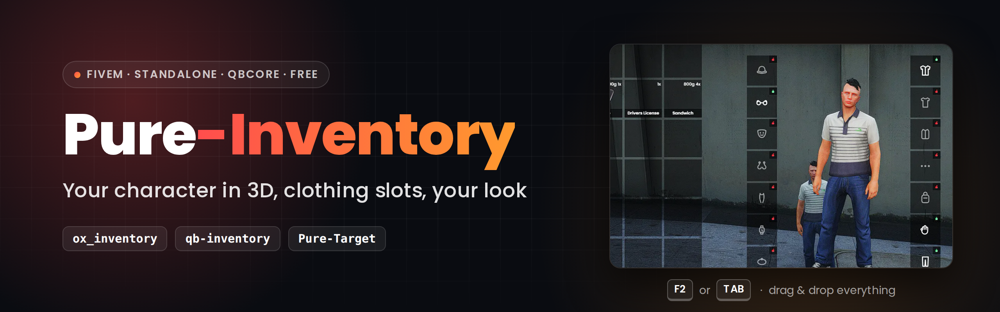
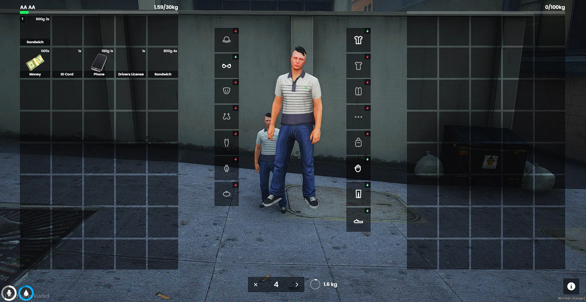

<details name="langue">
<summary><picture></picture></summary>

<div align="center">

<sub>🧩 <b>Suite Pure</b> &nbsp;·&nbsp; <a href="https://github.com/ma3iich/pure-target">Pure-Target</a> (menu clic droit) &nbsp;·&nbsp; <b>Pure Inventory</b> (inventaire) &nbsp;—&nbsp; chacun marche seul, et ils marchent ensemble</sub>



<br>

**Un inventaire à cases pour FiveM avec ton personnage en 3D, des cases de vêtements et un rendu réglable dans un seul fichier.**<br>
Standalone, ou prêt à l'emploi avec QBCore. Fork d'`ox_inventory` : tous les scripts faits pour `ox_inventory` continuent de marcher.

[](https://fivem.net)
[](https://www.lua.org)
[](#-installation)
[](LICENSE)
[](https://github.com/ma3iich/pure_inventory/releases)
[](https://www.youtube.com/watch?v=n8H1ayGNnV0)
[](https://discord.gg/C4jc8k3dD9)

**[⬇️ Télécharger](https://github.com/ma3iich/pure_inventory/releases/latest)** &nbsp;·&nbsp;
**[🎬 Tuto vidéo](https://www.youtube.com/watch?v=n8H1ayGNnV0)** &nbsp;·&nbsp;
**[📦 Installation](#-installation)** &nbsp;·&nbsp;
**[⚙️ Configuration](#%EF%B8%8F-configuration)** &nbsp;·&nbsp;
**[🗄️ SQL](sql/README.md)** &nbsp;·&nbsp;
**[❓ FAQ](#-faq)**

<sub>Fork d'<a href="https://github.com/overextended/ox_inventory">ox_inventory</a> par Overextended (version QBCore maintenue par <a href="https://github.com/TheOrderFivem/ox_inventory">TheOrderFivem</a>) · Fait par <a href="https://github.com/ma3iich">ma3iich</a></sub>



</div>

---

## 🎬 Aperçus

<table>
  <tr>
    <th width="33%">🖱️ Glisser-déposer</th>
    <th width="33%">👕 Cases de vêtements</th>
    <th width="33%">🍔 Utiliser sur ton perso</th>
  </tr>
  <tr>
    <td><video src="https://github.com/user-attachments/assets/6e9ac890-b6db-4870-b305-758e6a581e72" width="100%" controls muted></video></td>
    <td><video src="https://github.com/user-attachments/assets/6cd18932-d0d6-4f7c-8e42-12e1e3ea58dd" width="100%" controls muted></video></td>
    <td><video src="https://github.com/user-attachments/assets/6b5c38c5-7e68-41d4-b09f-20e5dd7282af" width="100%" controls muted></video></td>
  </tr>
  <tr>
    <th>🧍 Perso 3D</th>
    <th>🔢 Quantité</th>
    <th>⌨️ Tes propres touches</th>
  </tr>
  <tr>
    <td><video src="https://github.com/user-attachments/assets/8f959996-75ed-436c-80b7-85f4c70e5fc6" width="100%" controls muted></video></td>
    <td><video src="https://github.com/user-attachments/assets/07240999-15d9-42c6-90ff-a85b6c3d3f21" width="100%" controls muted></video></td>
    <td><video src="https://github.com/user-attachments/assets/1460e671-0f3c-4d78-81a8-284b044cf568" width="100%" controls muted></video></td>
  </tr>
</table>

---

## ✨ Fonctionnalités

<table>
  <tr>
    <td width="50%">🧍 <b>Ton personnage en 3D</b><br><sub>Au milieu de l'inventaire. Clic gauche maintenu pour le tourner, molette pour zoomer. Il reste immobile à l'écran même quand tu marches ou conduis.</sub></td>
    <td width="50%">👕 <b>Cases de vêtements</b><br><sub>Clique sur un vêtement porté (ou glisse-le dans l'inventaire) pour l'enlever : il devient un objet. Glisse-le sur ton personnage pour le remettre.</sub></td>
  </tr>
  <tr>
    <td>🎨 <b>Ton rendu dans un seul fichier</b><br><sub>Couleur et opacité des cases, taille, nombre de lignes, coins arrondis, police, couleurs du menu, icônes des vêtements : tout est dans <code>config.lua</code>.</sub></td>
    <td>🖱️ <b>Glisser-déposer partout</b><br><sub>Un objet lâché sur ton personnage est utilisé, sur une case de vêtement il est enfilé, un vêtement porté va dans la case de ton choix.</sub></td>
  </tr>
  <tr>
    <td>✏️ <b>Renommer dans la case</b><br><sub>Clic droit &gt; Renommer, tape le nouveau nom directement dans la case. Entrée pour enregistrer, Échap pour annuler.</sub></td>
    <td>🚶 <b>Reste ouvert</b><br><sub>Marche inventaire ouvert ; il reste ouvert quand tu manges, bois, te soignes, changes de vêtement, ou pendant une barre de chargement.</sub></td>
  </tr>
  <tr>
    <td>🔌 <b>Standalone ou QBCore</b><br><sub>Détecte ton framework tout seul (QBCore, Qbox, ESX, ox_core, ND), ou fonctionne sans framework.</sub></td>
    <td>🔒 <b>Serveur renforcé</b><br><sub>Contrôles serveur en plus sur chaque déplacement, dépôt, don, fabrication, achat et action d'arme (voir <a href="#-différences-avec-ox_inventory">différences</a>).</sub></td>
  </tr>
</table>

Plus de 13 langues : English, Français, Deutsch, Español, Italiano, Português, Nederlands, Polski, Türkçe, Русский, 中文, 日本語, 한국어 (+ celles d'ox_inventory).

---

## 📋 Dépendances

| Ressource | Obligatoire | Remarques |
| --- | --- | --- |
| [oxmysql](https://github.com/overextended/oxmysql) | ✅ | 2.7.3 ou plus récent |
| [ox_lib](https://github.com/overextended/ox_lib) | ✅ | 3.27.0 ou plus récent (ox_lib 3.41+ a aussi besoin de `cfxlua-require`, fourni dans son zip) |
| Serveur FiveM | ✅ | artifact 6116 ou plus récent, **OneSync** activé |
| qb-core / qbx_core / es_extended / ox_core / ND_Core | facultatif | sans framework : mode standalone |
| ox_target ou [pure-target](https://github.com/ma3iich/pure-target) | facultatif | seulement avec `Config.Target = true` |
| progressbar (QBCore) | facultatif | l'inventaire reste ouvert pendant ses barres de chargement |
| un script d'apparence (illenium-appearance, qb-clothing...) | facultatif | les cases de vêtements marchent avec n'importe lequel |

---

## 📦 Installation

1. Télécharge la [dernière version](https://github.com/ma3iich/pure_inventory/releases/latest) et mets le dossier `pure_inventory` dans tes `resources`.
2. **Retire `ox_inventory` et `qb-inventory`** (Pure Inventory les remplace : jamais deux inventaires en même temps).
3. Dans `server.cfg`, après `oxmysql`, `ox_lib` et ton framework :
   ```cfg
   ensure oxmysql
   ensure ox_lib
   ensure qb-core          # si tu utilises QBCore
   ensure pure_inventory
   ```
4. Démarre le serveur : les tables se créent toutes seules ([fichiers SQL](sql/README.md) si tu préfères les lancer toi-même).
5. Facultatif : ouvre `config.lua` et règle la langue, les cases et le rendu.

**QBCore :** rien d'autre à faire. Au premier démarrage, les objets de QBCore sont recopiés dans `data/items.lua` (redémarre une fois, comme ox_inventory).
`exports['qb-inventory']` (AddItem, RemoveItem, HasItem...) et les fonctions joueur de QBCore continuent de marcher.

**Standalone :** les joueurs sont enregistrés par leur licence FiveM. Les métiers (police...) viennent des permissions ACE :
```cfg
add_ace group.police pure_inventory.group.police allow
add_principal identifier.license:xxxxxxxx group.police
```

**Tu viens d'ox_inventory :** tes données restent (mêmes tables, même format de `data/*.lua` : recopie tes objets, magasins, coffres...).
Les `exports.ox_inventory:...` de tes autres scripts marchent, et `GetResourceState('ox_inventory')` répond `started`.

---

## ⚙️ Configuration

Tout est dans **`config.lua`**, avec un commentaire sur chaque ligne. Les grandes parties :

| Partie | Ce que tu règles |
| --- | --- |
| Général | framework (`auto`), langue, contrôle des mises à jour (`CheckUpdates`) |
| Inventaire du joueur | cases, poids, touches, métiers de police |
| Comportement | reste ouvert quand on utilise un objet (et les objets qui le ferment quand même), marcher inventaire ouvert, flou, renommer |
| Rendu (`Config.Theme`) | couleur **et opacité** des cases, opacité au survol, liseré, taille, espace, colonnes, lignes visibles, coins arrondis, bande du nom, couleur du texte, majuscules, police, couleurs du menu, taille / couleur des icônes / couleurs des cadenas des cases de vêtements |
| Personnage 3D | position, taille, pose, lumière, zoom |
| Cases de vêtements | quelles cases, de quel côté, **leur icône** (intégrée ou ton image), poids, valeurs « nu », animations, images avec Pure Clothing (`Pictures`), partie « Vêtements » du menu radial (`DisableRadialClothing`) |
| Standalone | identifiant, groupes ACE, durée de conservation des coffres |
| Avancé | les options d'origine d'ox_inventory |

Une convar `inventory:<nom>` (ox.cfg d'ox_inventory) remplace toujours le réglage correspondant.
Ton webhook Discord reste dans `server.cfg` (`set inventory:webhook "..."`) : jamais dans `config.lua`, qui est envoyé aux joueurs.

Objets, magasins, coffres, établis et coffres de véhicules sont dans `data/` exactement comme ox_inventory
([documentation](https://coxdocs.dev/ox_inventory)).

---

## 👕 Comment marchent les cases de vêtements

- Chaque case est un composant ou un accessoire de GTA (`Config.Clothing.Slots`). Vêtement porté = cadenas vert, retiré = cadenas rouge.
- Enlever un vêtement donne un objet `clothing` qui retient le modèle, le dessin et la texture. Il ne va qu'aux personnages du même modèle (homme / femme freemode).
- Ce qu'un personnage a enlevé est enregistré (`pure_inventory_clothing`) : quand ton script d'apparence rhabille le personnage après une reconnexion, les vêtements enlevés sont retirés de nouveau. Un vêtement ne peut donc jamais devenir deux objets.
- Changer de vêtements dans un magasin de vêtements reprend simplement la main : le magasin décide pour les pièces changées.
- Seuls les personnages freemode (`mp_m_freemode_01` / `mp_f_freemode_01`) ont des cases de vêtements.
- Limite de GTA : les gants font partie du composant « bras », dont la forme dépend du haut. Enlever le haut dénude aussi les bras ; ils reviennent avec le haut.
- Menu radial : sa partie « Vêtements » (enlever / remettre le haut, le pantalon...) déshabille le personnage sans passer par les cases, et le vêtement ne devient jamais un objet. Avec `Config.Clothing.DisableRadialClothing` (par défaut), l'inventaire retire cette partie du menu de `qbx_radialmenu` (Qbox). `qb-radialmenu` ne permet pas de retirer une de ses entrées depuis un autre script : l'inventaire affiche un avertissement dans la console du serveur ; supprime l'entrée `clothesmenu` de `Config.MenuItems` dans `qb-radialmenu/config.lua`.

---

## ❓ FAQ

<details><summary><b>Un script dit qu'il lui faut ox_inventory</b></summary>
Pure Inventory déclare <code>provide 'ox_inventory'</code> et répond à <code>exports.ox_inventory</code>. Si un script cherche encore le nom du dossier, renomme le dossier <code>pure_inventory</code> en <code>ox_inventory</code> : tout marche sous les deux noms.
</details>

<details><summary><b>Les images d'objets d'autres scripts n'apparaissent pas</b></summary>
Les scripts qui affichent les images avec l'adresse <code>nui://ox_inventory/web/images/...</code> ont besoin de <code>nui://pure_inventory/web/images/...</code> (ou renomme le dossier en <code>ox_inventory</code>).
</details>

<details><summary><b>Je ne veux pas le personnage 3D / les cases de vêtements</b></summary>
<code>Config.PedPreview.Enabled = false</code> et / ou <code>Config.Clothing.Enabled = false</code>.
</details>

<details><summary><b>Comment changer l'icône d'une case de vêtement ?</b></summary>
Dans <code>Config.Clothing.Slots</code>, mets dans <code>icon</code> un autre nom d'icône intégrée ou ta propre image : <code>icon = 'nui://ma_ressource/icones/chapeau.png'</code>. L'image des objets vêtements est <code>web/images/clothing_&lt;case&gt;.png</code>.
</details>

<details><summary><b>Où signaler un bug ?</b></summary>
Viens sur le <a href="https://discord.gg/C4jc8k3dD9">Discord</a> et ouvre un ticket, avec la console du serveur et la console F8.
</details>

---

## 🔁 Différences avec ox_inventory

Pure Inventory part d'**ox_inventory 2.45.1** (fork TheOrderFivem, le dernier qui gère QBCore). Principaux changements :

- **Nouveau :** personnage 3D, cases de vêtements, renommer dans la case, nouveau rendu piloté par `config.lua`, compteur de quantité (× / ›), anneau de poids, mode standalone, détection automatique du framework, `config.lua` au lieu des convars, japonais + nouveaux textes en 13 langues.
- **Comportement :** reste ouvert quand on utilise un objet / pendant les barres de chargement ox_lib et QBCore, marcher inventaire ouvert, se ferme quand une autre fenêtre prend le clavier, objets à lancer repris en main l'un après l'autre, animations chargées avant la barre, objets qui s'usent qui quittent leur pile un par un, conteneurs vides empilables, conteneurs sans poids / imbriquables.
- **Sécurité (côté serveur) :** contrôles à chaque déplacement (toujours le droit d'utiliser l'autre inventaire : distance, plaque, verrou, droits de police / de vol), nombres entiers seulement, joueur menotté ou mort sans déplacement / utilisation / don, tas au sol limités et posés là où est le joueur, un joueur n'ouvre que SON coffre personnel, identifiant de coffre / boîte à gants tiré du véhicule, un client ne lit que son propre inventaire, fabrication impossible à sauter ou à lancer deux fois, achats revérifiés (métier, distance, quantité), actions d'arme vérifiées (munitions, accessoires, bidons), poubelles et casiers de preuves vérifiés par modèle / distance, « patron » = patron de CE métier.
- **Corrections :** la fouille d'un joueur ne ferme plus l'inventaire du fouilleur quand l'autre ouvre le sien, plaque exacte, armes avec un accessoire sans pièce GTA, armes en véhicule, `clearevidence` vide vraiment le casier, fichier de langue espagnol.

La liste complète est l'historique git de ce dépôt.

---

## 📜 Licence

Pure Inventory est une version modifiée d'ox_inventory, publiée sous **GNU GPL v3** comme l'original ([LICENSE](LICENSE)).
Copyright © 2026 ma3iich · basé sur ox_inventory, copyright © 2023 Overextended et contributeurs ([NOTICE](NOTICE.md)).
Les sources de l'interface sont dans `web/src` (`cd web && npm install && npm run build`).

</details>
<details name="langue" open>
<summary><picture></picture></summary>

<div align="center">

<sub>🧩 <b>Pure suite</b> &nbsp;·&nbsp; <a href="https://github.com/ma3iich/pure-target">Pure-Target</a> (right-click menu) &nbsp;·&nbsp; <b>Pure Inventory</b> (inventory) &nbsp;—&nbsp; each one works standalone, and they work together</sub>


<br>

**A slot inventory for FiveM with your character in 3D, clothing slots and a look you set in one file.**<br>
Standalone, or plug & play with QBCore. Fork of `ox_inventory`, every `ox_inventory` script keeps working.

[](https://fivem.net)
[](https://www.lua.org)
[](#-installation-1)
[](LICENSE)
[](https://github.com/ma3iich/pure_inventory/releases)
[](https://www.youtube.com/watch?v=n8H1ayGNnV0)
[](https://discord.gg/C4jc8k3dD9)

**[⬇️ Download](https://github.com/ma3iich/pure_inventory/releases/latest)** &nbsp;·&nbsp;
**[🎬 Video tutorial](https://www.youtube.com/watch?v=n8H1ayGNnV0)** &nbsp;·&nbsp;
**[📦 Installation](#-installation-1)** &nbsp;·&nbsp;
**[⚙️ Configuration](#%EF%B8%8F-configuration-1)** &nbsp;·&nbsp;
**[🗄️ SQL](sql/README.md)** &nbsp;·&nbsp;
**[❓ FAQ](#-faq-1)**

<sub>Fork of <a href="https://github.com/overextended/ox_inventory">ox_inventory</a> by Overextended (QBCore version kept by <a href="https://github.com/TheOrderFivem/ox_inventory">TheOrderFivem</a>) · Made by <a href="https://github.com/ma3iich">ma3iich</a></sub>


</div>

---

## 🎬 Preview

<table>
  <tr>
    <th width="33%">🖱️ Drag &amp; drop</th>
    <th width="33%">👕 Clothing slots</th>
    <th width="33%">🍔 Use on your character</th>
  </tr>
  <tr>
    <td><video src="https://github.com/user-attachments/assets/6e9ac890-b6db-4870-b305-758e6a581e72" width="100%" controls muted></video></td>
    <td><video src="https://github.com/user-attachments/assets/6cd18932-d0d6-4f7c-8e42-12e1e3ea58dd" width="100%" controls muted></video></td>
    <td><video src="https://github.com/user-attachments/assets/6b5c38c5-7e68-41d4-b09f-20e5dd7282af" width="100%" controls muted></video></td>
  </tr>
  <tr>
    <th>🧍 3D character</th>
    <th>🔢 Amount</th>
    <th>⌨️ Your own keys</th>
  </tr>
  <tr>
    <td><video src="https://github.com/user-attachments/assets/8f959996-75ed-436c-80b7-85f4c70e5fc6" width="100%" controls muted></video></td>
    <td><video src="https://github.com/user-attachments/assets/07240999-15d9-42c6-90ff-a85b6c3d3f21" width="100%" controls muted></video></td>
    <td><video src="https://github.com/user-attachments/assets/1460e671-0f3c-4d78-81a8-284b044cf568" width="100%" controls muted></video></td>
  </tr>
</table>

---

## ✨ Features

<table>
  <tr>
    <td width="50%">🧍 <b>Your character in 3D</b><br><sub>In the middle of the inventory. Hold left click to turn it, mouse wheel to zoom. It stays still on screen even when you walk or drive.</sub></td>
    <td width="50%">👕 <b>Clothing slots</b><br><sub>Click a piece you wear (or drag it into your inventory) to take it off: it becomes an item. Drag it back on your character to put it on.</sub></td>
  </tr>
  <tr>
    <td>🎨 <b>Your look in one file</b><br><sub>Colour and opacity of the slots, size, rows, rounded corners, font, menu colours, clothing icons: everything is in <code>config.lua</code>.</sub></td>
    <td>🖱️ <b>Drag &amp; drop everywhere</b><br><sub>Drop an item on your character to use it, on a clothing slot to wear it, a worn piece into a precise slot of your inventory.</sub></td>
  </tr>
  <tr>
    <td>✏️ <b>Rename in the slot</b><br><sub>Right click &gt; Rename, type the new name directly in the slot. Enter to save, Escape to cancel.</sub></td>
    <td>🚶 <b>Stays open</b><br><sub>Walk with the inventory open; it stays open when you eat, drink, heal, change clothes, or during a progress bar.</sub></td>
  </tr>
  <tr>
    <td>🔌 <b>Standalone or QBCore</b><br><sub>Detects your framework by itself (QBCore, Qbox, ESX, ox_core, ND), or works without any framework.</sub></td>
    <td>🔒 <b>Hardened server</b><br><sub>Extra server checks on every move, drop, give, craft, purchase and weapon action (see <a href="#-changes-from-ox_inventory">changes</a>).</sub></td>
  </tr>
</table>

13+ languages: English, Français, Deutsch, Español, Italiano, Português, Nederlands, Polski, Türkçe, Русский, 中文, 日本語, 한국어 (+ the ox_inventory ones).

---

## 📋 Dependencies

| Resource | Needed | Notes |
| --- | --- | --- |
| [oxmysql](https://github.com/overextended/oxmysql) | ✅ | 2.7.3 or newer |
| [ox_lib](https://github.com/overextended/ox_lib) | ✅ | 3.27.0 or newer (ox_lib 3.41+ also needs `cfxlua-require`, shipped in its zip) |
| FiveM server | ✅ | artifact 6116 or newer, **OneSync** enabled |
| qb-core / qbx_core / es_extended / ox_core / ND_Core | optional | without one, standalone mode |
| ox_target or [pure-target](https://github.com/ma3iich/pure-target) | optional | only with `Config.Target = true` |
| progressbar (QBCore) | optional | the inventory stays open during its progress bars |
| an appearance script (illenium-appearance, qb-clothing...) | optional | the clothing slots work with any of them |

---

## 📦 Installation

1. Download the [latest release](https://github.com/ma3iich/pure_inventory/releases/latest) and put the `pure_inventory` folder in your `resources`.
2. **Remove `ox_inventory` and `qb-inventory`** (Pure Inventory replaces them, never run two inventories).
3. In `server.cfg`, after `oxmysql`, `ox_lib` and your framework:
   ```cfg
   ensure oxmysql
   ensure ox_lib
   ensure qb-core          # if you use QBCore
   ensure pure_inventory
   ```
4. Start the server: the tables are created by themselves ([SQL files](sql/README.md) if you prefer to run them).
5. Optional: open `config.lua` and set the language, the slots and the look.

**QBCore:** nothing else to do. On the first start, the QBCore items are copied into `data/items.lua` (restart once, like ox_inventory).
`exports['qb-inventory']` (AddItem, RemoveItem, HasItem...) and the QBCore player functions keep working.

**Standalone:** players are saved by their FiveM license. Jobs (police...) come from ACE permissions:
```cfg
add_ace group.police pure_inventory.group.police allow
add_principal identifier.license:xxxxxxxx group.police
```

**Coming from ox_inventory:** your data stays (same tables, same `data/*.lua` format: copy your items, shops, stashes...).
Every `exports.ox_inventory:...` call of your other scripts works, and `GetResourceState('ox_inventory')` answers `started`.

---

## ⚙️ Configuration

Everything is in **`config.lua`**, with a comment on each line. The main parts:

| Part | What you set |
| --- | --- |
| General | framework (`auto`), language, update check (`CheckUpdates`) |
| Player inventory | slots, weight, keys, police jobs |
| Behaviour | stays open when an item is used (and which items still close it), walk while open, blur, rename |
| Look (`Config.Theme`) | slot colour **and opacity**, hover opacity, outline, size, gap, columns, visible rows, rounded corners, label band, text colour, capitals, font, menu colours, clothing slot size / icon colour / lock colours |
| Character preview | position, size, pose, light, zoom |
| Clothing slots | which slots, on which side, **their icon** (built-in or your own image), weight, "naked" values, animations, pictures with Pure Clothing (`Pictures`), "Clothing" part of the radial menu (`DisableRadialClothing`) |
| Standalone | identifier, ACE groups, how long trunks are kept |
| Advanced | the original ox_inventory options |

An `inventory:<name>` convar (ox.cfg of ox_inventory) still overrides the matching setting.
Your Discord webhook stays in `server.cfg` (`set inventory:webhook "..."`): never in `config.lua`, which is sent to the players.

Items, shops, stashes, crafting benches and vehicle storages are in `data/` exactly like ox_inventory
([documentation](https://coxdocs.dev/ox_inventory)).

---

## 👕 How the clothing slots work

- Each slot is a GTA component or prop (`Config.Clothing.Slots`). A worn piece shows a green lock, a removed one a red lock.
- Taking a piece off gives a `clothing` item that remembers the model, the drawable and the texture. It only fits characters of the same model (male / female freemode).
- What a character took off is saved (`pure_inventory_clothing`): when your appearance script dresses the character again after a reconnection, the removed pieces are taken off again, so a piece can never be turned into an item twice.
- Changing clothes in a clothing shop simply takes over: the shop decides for the pieces you changed there.
- Only freemode characters (`mp_m_freemode_01` / `mp_f_freemode_01`) have clothing slots.
- GTA limit: gloves are part of the "arms" component, whose shape depends on the top. Taking the top off also bares the arms; the arms come back with the top.
- Radial menu: its "Clothing" part (take off / put back the top, the pants...) undresses the character without the slots, and the piece never becomes an item. With `Config.Clothing.DisableRadialClothing` (default), the inventory removes that part from the menu of `qbx_radialmenu` (Qbox). `qb-radialmenu` gives no way to remove one of its entries from another script: the inventory prints a warning in the server console; delete the `clothesmenu` entry of `Config.MenuItems` in `qb-radialmenu/config.lua`.

---

## ❓ FAQ

<details><summary><b>A script says it needs ox_inventory</b></summary>
Pure Inventory declares <code>provide 'ox_inventory'</code> and answers <code>exports.ox_inventory</code>. If a script still looks for the folder name, rename the folder <code>pure_inventory</code> to <code>ox_inventory</code>: everything works under both names.
</details>

<details><summary><b>Item pictures of other scripts are missing</b></summary>
Scripts that show pictures with the address <code>nui://ox_inventory/web/images/...</code> need <code>nui://pure_inventory/web/images/...</code> (or rename the folder to <code>ox_inventory</code>).
</details>

<details><summary><b>I don't want the 3D character / the clothing slots</b></summary>
<code>Config.PedPreview.Enabled = false</code> and / or <code>Config.Clothing.Enabled = false</code>.
</details>

<details><summary><b>How do I change the icon of a clothing slot?</b></summary>
In <code>Config.Clothing.Slots</code>, set <code>icon</code> to another built-in name or to your own image: <code>icon = 'nui://my_resource/icons/hat.png'</code>. The picture of the clothing items is <code>web/images/clothing_&lt;slot&gt;.png</code>.
</details>

<details><summary><b>Where do I report a bug?</b></summary>
Come to the <a href="https://discord.gg/C4jc8k3dD9">Discord</a> and open a ticket, with your server console and F8 console.
</details>

---

## 🔁 Changes from ox_inventory

Pure Inventory starts from **ox_inventory 2.45.1** (TheOrderFivem fork, the last one with QBCore support). Main changes:

- **New:** 3D character, clothing slots, rename in the slot, new look driven by `config.lua`, amount counter (× / ›), weight ring, standalone mode, automatic framework detection, `config.lua` instead of convars, Japanese + new texts in 13 languages.
- **Behaviour:** stays open when an item is used / during ox_lib and QBCore progress bars, walk while open, closes when another window takes the keyboard, throwables taken in hand one after the other, animations loaded before the progress bar, items that wear out leave their stack one by one, stackable empty containers, weightless / nestable containers.
- **Security (server side):** checks on every move (still allowed to use the other inventory: distance, plate, lock, police / steal rights), whole numbers only, handcuffed or dead players cannot move / use / give items, piles on the ground limited and placed where the player stands, a player can only open his own personal stash, trunk and glovebox ids come from the vehicle, clients can only read their own inventory, crafting cannot be skipped or done twice at once, purchases checked again (job, distance, amount), weapon actions checked (ammo, attachments, cans), dumpsters and evidence lockers checked by model / distance, "boss" means boss of that job.
- **Fixes:** search of a player no longer closes the searcher's inventory when the other player opens his own, exact plate match, weapons with an attachment without GTA component, weapons in vehicles, `clearevidence` really empties the locker, Spanish locale file.

The full list of changes is the git history of this repository.

---

## 📜 License

Pure Inventory is a modified version of ox_inventory, released under the **GNU GPL v3** like the original ([LICENSE](LICENSE)).
Copyright © 2026 ma3iich · based on ox_inventory, copyright © 2023 Overextended and contributors ([NOTICE](NOTICE.md)).
The interface sources are in `web/src` (`cd web && npm install && npm run build`).

</details>
