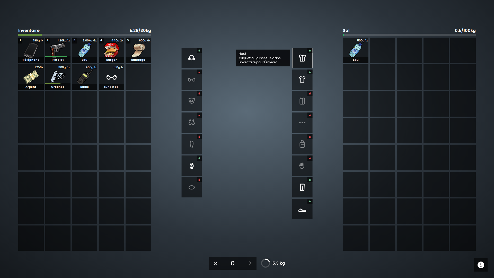

<div align="center">

[](README.md) [](README.fr.md)

# Pure Inventory

**A slot inventory for FiveM with your character in 3D, clothing slots and a look you set in one file.**<br>
Standalone, or plug & play with QBCore. Fork of `ox_inventory`, every `ox_inventory` script keeps working.

[](https://fivem.net)
[](https://www.lua.org)
[](#-installation)
[](LICENSE)

**[⬇️ Download](https://github.com/ma3iich/pure_inventory/releases/latest)** &nbsp;·&nbsp;
**[📦 Installation](#-installation)** &nbsp;·&nbsp;
**[⚙️ Configuration](#%EF%B8%8F-configuration)** &nbsp;·&nbsp;
**[🗄️ SQL](sql/README.md)** &nbsp;·&nbsp;
**[❓ FAQ](#-faq)**

<sub>Fork of <a href="https://github.com/overextended/ox_inventory">ox_inventory</a> by Overextended (QBCore version kept by <a href="https://github.com/TheOrderFivem/ox_inventory">TheOrderFivem</a>) · Made by <a href="https://github.com/ma3iich">ma3iich</a></sub>



</div>

---

## ✨ Features

<table>
  <tr>
    <td width="50%">🧍 <b>Your character in 3D</b><br><sub>In the middle of the inventory. Hold left click to turn it, mouse wheel to zoom. It stays still on screen even when you walk or drive.</sub></td>
    <td width="50%">👕 <b>Clothing slots</b><br><sub>Click a piece you wear (or drag it into your inventory) to take it off: it becomes an item. Drag it back on your character to put it on.</sub></td>
  </tr>
  <tr>
    <td>🎨 <b>Your look in one file</b><br><sub>Colour and opacity of the slots, size, rows, rounded corners, font, menu colours, clothing icons: everything is in <code>config.lua</code>.</sub></td>
    <td>🖱️ <b>Drag &amp; drop everywhere</b><br><sub>Drop an item on your character to use it, on a clothing slot to wear it, a worn piece into a precise slot of your inventory.</sub></td>
  </tr>
  <tr>
    <td>✏️ <b>Rename in the slot</b><br><sub>Right click &gt; Rename, type the new name directly in the slot. Enter to save, Escape to cancel.</sub></td>
    <td>🚶 <b>Stays open</b><br><sub>Walk with the inventory open; it stays open when you eat, drink, heal, change clothes, or during a progress bar.</sub></td>
  </tr>
  <tr>
    <td>🔌 <b>Standalone or QBCore</b><br><sub>Detects your framework by itself (QBCore, Qbox, ESX, ox_core, ND), or works without any framework.</sub></td>
    <td>🔒 <b>Hardened server</b><br><sub>Extra server checks on every move, drop, give, craft, purchase and weapon action (see <a href="#-changes-from-ox_inventory">changes</a>).</sub></td>
  </tr>
</table>

13+ languages: English, Français, Deutsch, Español, Italiano, Português, Nederlands, Polski, Türkçe, Русский, 中文, 日本語, 한국어 (+ the ox_inventory ones).

---

## 📋 Dependencies

| Resource | Needed | Notes |
| --- | --- | --- |
| [oxmysql](https://github.com/overextended/oxmysql) | ✅ | 2.7.3 or newer |
| [ox_lib](https://github.com/overextended/ox_lib) | ✅ | 3.27.0 or newer (ox_lib 3.41+ also needs `cfxlua-require`, shipped in its zip) |
| FiveM server | ✅ | artifact 6116 or newer, **OneSync** enabled |
| qb-core / qbx_core / es_extended / ox_core / ND_Core | optional | without one, standalone mode |
| ox_target or [pure-target](https://github.com/ma3iich/pure-target) | optional | only with `Config.Target = true` |
| progressbar (QBCore) | optional | the inventory stays open during its progress bars |
| an appearance script (illenium-appearance, qb-clothing...) | optional | the clothing slots work with any of them |

---

## 📦 Installation

1. Download the [latest release](https://github.com/ma3iich/pure_inventory/releases/latest) and put the `pure_inventory` folder in your `resources`.
2. **Remove `ox_inventory` and `qb-inventory`** (Pure Inventory replaces them, never run two inventories).
3. In `server.cfg`, after `oxmysql`, `ox_lib` and your framework:
   ```cfg
   ensure oxmysql
   ensure ox_lib
   ensure qb-core          # if you use QBCore
   ensure pure_inventory
   ```
4. Start the server: the tables are created by themselves ([SQL files](sql/README.md) if you prefer to run them).
5. Optional: open `config.lua` and set the language, the slots and the look.

**QBCore:** nothing else to do. On the first start, the QBCore items are copied into `data/items.lua` (restart once, like ox_inventory).
`exports['qb-inventory']` (AddItem, RemoveItem, HasItem...) and the QBCore player functions keep working.

**Standalone:** players are saved by their FiveM license. Jobs (police...) come from ACE permissions:
```cfg
add_ace group.police pure_inventory.group.police allow
add_principal identifier.license:xxxxxxxx group.police
```

**Coming from ox_inventory:** your data stays (same tables, same `data/*.lua` format: copy your items, shops, stashes...).
Every `exports.ox_inventory:...` call of your other scripts works, and `GetResourceState('ox_inventory')` answers `started`.

---

## ⚙️ Configuration

Everything is in **`config.lua`**, with a comment on each line. The main parts:

| Part | What you set |
| --- | --- |
| General | framework (`auto`), language |
| Player inventory | slots, weight, keys, police jobs |
| Behaviour | stays open when an item is used (and which items still close it), walk while open, blur, rename |
| Look (`Config.Theme`) | slot colour **and opacity**, hover opacity, outline, size, gap, columns, visible rows, rounded corners, label band, text colour, capitals, font, menu colours, clothing slot size / icon colour / lock colours |
| Character preview | position, size, pose, light, zoom |
| Clothing slots | which slots, on which side, **their icon** (built-in or your own image), weight, "naked" values, animations |
| Standalone | identifier, ACE groups, how long trunks are kept |
| Advanced | the original ox_inventory options |

An `inventory:<name>` convar (ox.cfg of ox_inventory) still overrides the matching setting.
Your Discord webhook stays in `server.cfg` (`set inventory:webhook "..."`): never in `config.lua`, which is sent to the players.

Items, shops, stashes, crafting benches and vehicle storages are in `data/` exactly like ox_inventory
([documentation](https://coxdocs.dev/ox_inventory)).

---

## 👕 How the clothing slots work

- Each slot is a GTA component or prop (`Config.Clothing.Slots`). A worn piece shows a green lock, a removed one a red lock.
- Taking a piece off gives a `clothing` item that remembers the model, the drawable and the texture. It only fits characters of the same model (male / female freemode).
- What a character took off is saved (`pure_inventory_clothing`): when your appearance script dresses the character again after a reconnection, the removed pieces are taken off again, so a piece can never be turned into an item twice.
- Changing clothes in a clothing shop simply takes over: the shop decides for the pieces you changed there.
- Only freemode characters (`mp_m_freemode_01` / `mp_f_freemode_01`) have clothing slots.
- GTA limit: gloves are part of the "arms" component, whose shape depends on the top. Taking the top off also bares the arms; the arms come back with the top.

---

## ❓ FAQ

<details><summary><b>A script says it needs ox_inventory</b></summary>
Pure Inventory declares <code>provide 'ox_inventory'</code> and answers <code>exports.ox_inventory</code>. If a script still looks for the folder name, rename the folder <code>pure_inventory</code> to <code>ox_inventory</code>: everything works under both names.
</details>

<details><summary><b>Item pictures of other scripts are missing</b></summary>
Scripts that show pictures with the address <code>nui://ox_inventory/web/images/...</code> need <code>nui://pure_inventory/web/images/...</code> (or rename the folder to <code>ox_inventory</code>).
</details>

<details><summary><b>I don't want the 3D character / the clothing slots</b></summary>
<code>Config.PedPreview.Enabled = false</code> and / or <code>Config.Clothing.Enabled = false</code>.
</details>

<details><summary><b>How do I change the icon of a clothing slot?</b></summary>
In <code>Config.Clothing.Slots</code>, set <code>icon</code> to another built-in name or to your own image: <code>icon = 'nui://my_resource/icons/hat.png'</code>. The picture of the clothing items is <code>web/images/clothing_&lt;slot&gt;.png</code>.
</details>

<details><summary><b>Where do I report a bug?</b></summary>
Open an <a href="https://github.com/ma3iich/pure_inventory/issues">issue</a> with your server console and F8 console.
</details>

---

## 🔁 Changes from ox_inventory

Pure Inventory starts from **ox_inventory 2.45.1** (TheOrderFivem fork, the last one with QBCore support). Main changes:

- **New:** 3D character, clothing slots, rename in the slot, new look driven by `config.lua`, amount counter (× / ›), weight ring, standalone mode, automatic framework detection, `config.lua` instead of convars, Japanese + new texts in 13 languages.
- **Behaviour:** stays open when an item is used / during ox_lib and QBCore progress bars, walk while open, closes when another window takes the keyboard, throwables taken in hand one after the other, animations loaded before the progress bar, items that wear out leave their stack one by one, stackable empty containers, weightless / nestable containers.
- **Security (server side):** checks on every move (still allowed to use the other inventory: distance, plate, lock, police / steal rights), whole numbers only, handcuffed or dead players cannot move / use / give items, piles on the ground limited and placed where the player stands, a player can only open his own personal stash, trunk and glovebox ids come from the vehicle, clients can only read their own inventory, crafting cannot be skipped or done twice at once, purchases checked again (job, distance, amount), weapon actions checked (ammo, attachments, cans), dumpsters and evidence lockers checked by model / distance, "boss" means boss of that job.
- **Fixes:** search of a player no longer closes the searcher's inventory when the other player opens his own, exact plate match, weapons with an attachment without GTA component, weapons in vehicles, `clearevidence` really empties the locker, Spanish locale file.

The full list of changes is the git history of this repository.

---

## 📜 License

Pure Inventory is a modified version of ox_inventory, released under the **GNU GPL v3** like the original ([LICENSE](LICENSE)).
Copyright © Overextended and the ox_inventory contributors; modifications © ma3iich.
The interface sources are in `web/src` (`cd web && npm install && npm run build`).
